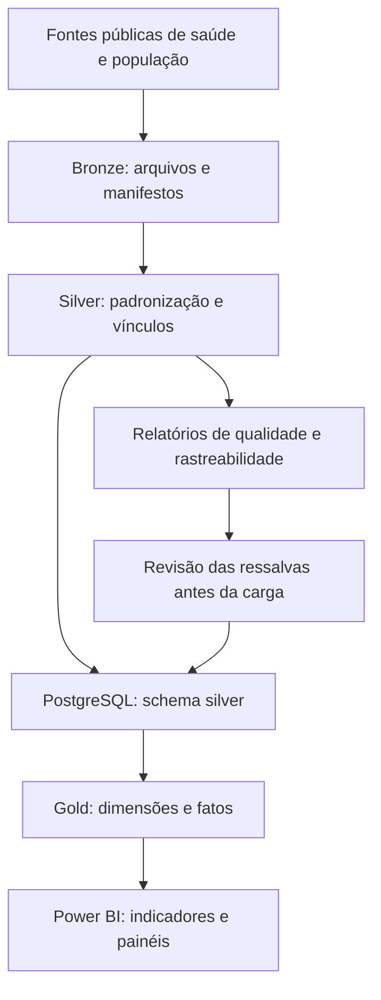

# Observatório COVID-19 Brasil

**Engenharia de dados e análise de indicadores de saúde pública — Brasil, 2020–2024**

Projeto de integração de bases públicas de saúde para explorar a distribuição territorial e temporal da SRAG por COVID-19, a estrutura hospitalar, a mortalidade e a produção hospitalar do SUS. O trabalho conecta coleta de dados, tratamento em Python, armazenamento relacional em PostgreSQL, modelagem analítica em SQL e visualização no Power BI.

O objetivo é construir indicadores rastreáveis: cada número apresentado no painel deve estar associado à fonte, ao período, à unidade de análise e às regras utilizadas em sua preparação.

> **Escopo:** o projeto combina bases com finalidades diferentes. Notificações de SRAG, declarações de óbito, registros de AIH e leitos cadastrados não representam a mesma unidade de análise. Os indicadores devem ser interpretados conforme a metodologia de cada fonte.


## Sumário

- [Visão geral](#visão-geral)
- [Arquitetura](#arquitetura)
- [Fontes e cobertura](#fontes-e-cobertura)
- [Etapas de desenvolvimento](#etapas-de-desenvolvimento)
- [Modelo analítico](#modelo-analítico)
- [Indicadores e regras de negócio](#indicadores-e-regras-de-negócio)
- [Painéis](#painéis)
- [Reprodução do fluxo](#reprodução-do-fluxo)
- [Limitações](#limitações)
- [Evolução do projeto](#evolução-do-projeto)

## Visão geral

O projeto foi organizado em três camadas de dados:

| Camada | Responsabilidade | Principais entregas |
|---|---|---|
| Bronze | Preservar os arquivos coletados e sua procedência | Arquivos de origem, Parquet, manifestos e relatórios de cobertura |
| Silver | Padronizar, validar e integrar os registros | Dados tratados, relatórios de qualidade, tabelas PostgreSQL e vínculos territoriais |
| Gold | Preparar dados para análise | Dimensões e fatos agregados consumidos pelo Power BI |

**Tecnologias utilizadas:** Python, pandas, PyArrow/Parquet, SQL, PostgreSQL, psycopg, Jupyter Notebook, pgAdmin, Power BI, Power Query e DAX.

As contagens deste documento correspondem às execuções locais conferidas durante o desenvolvimento. Atualizações das fontes podem produzir resultados diferentes.

## Arquitetura




A organização local inclui `Camada_Bronze/` e `Camada_Silver/`. Na Silver, os resultados são separados em `dados/`, `qualidade/` e `documentacao/`, com identificação de execução quando aplicável. A Gold está implementada no schema `gold` do PostgreSQL; não depende da existência de uma pasta física com esse nome.

## Fontes e cobertura

| Base | Uso no projeto | Recorte disponível | Volume conferido |
|---|---|---|---:|
| População municipal — IBGE | Denominadores populacionais e referência territorial | 2020–2024 | 27.853 registros município-ano |
| CNES — leitos | Estrutura hospitalar cadastrada por competência | 2020–2024 | 424.204 registros |
| SIVEP-Gripe — SRAG | Notificações, classificação final e evolução | Arquivos de 2020–2024 | 4.060.608 registros |
| SIM — mortalidade | Óbitos por todas as causas e recorte de COVID-19 | 2020–2024 | 7.931.364 registros |
| SIH/SUS | Produção hospitalar e valores registrados | Competências de processamento de 2020–2024 | 62.365.300 registros em 1.620 arquivos |
| Ocupação hospitalar | Registros de ocupação e saídas hospitalares | Arquivos localizados de 2020–2022 | 1.591.676 registros |

**Ocupação hospitalar:** não foram localizados arquivos de 2023 e 2024 na coleta utilizada. Essa ausência não significa ocupação zero. A disponibilidade de um arquivo anual também não garante cobertura diária completa dos estabelecimentos.

## Etapas de desenvolvimento

### 1. Coleta e preservação dos dados de origem

Os arquivos foram organizados por fonte e período na Bronze. Os manifestos disponíveis registram informações como URL de origem, data da coleta, formato, contagem de registros e hashes SHA-256.

Antes do tratamento, foram inspecionados:

- Arquivos encontrados e períodos ausentes.
- Quantidade de linhas e colunas.
- Tipos de dados e diferenças de layout entre anos.
- Formatos de datas, identificadores e códigos municipais.
- Categorias existentes e valores ausentes.

Essa inspeção permitiu identificar problemas antes da carga no banco, incluindo a recuperação necessária da mortalidade de 2022.

### 2. Construção da referência territorial e populacional

A população municipal do IBGE foi preparada como referência para os vínculos territoriais e os denominadores dos indicadores.

O processamento preservou os códigos municipais como texto e utilizou o código IBGE de sete dígitos como chave territorial de integração. A referência foi examinada por ano para identificar ausência de população e diferenças entre registros disponíveis.

Foram preservados três registros sem população informada. Ausência de população não foi convertida em zero.

### 3. Tratamento do CNES e correção dos vínculos municipais

Os dados mensais de leitos foram consolidados, tipados e vinculados à referência municipal. A comparação inicial por UF e nome do município revelou diferenças de grafia, espaços, acentuação e denominações.

Exemplos encontrados incluem `PARATI`, `MOJI MIRIM`, `BRASOPOLIS` e `SANTO ANTONIO DO LEVERGER`. As regras de normalização e equivalência foram incorporadas ao tratamento, evitando depender exclusivamente de correções posteriores no banco.

**Resultado conferido:** 424.204 registros com status `VINCULADO_COM_POPULACAO`, sem pendências de vínculo municipal nessa execução.

As inconsistências quantitativas, como leitos SUS superiores aos leitos existentes em determinados registros, foram sinalizadas para análise, preservando os valores de origem.

### 4. Padronização da SRAG

Os cinco arquivos anuais apresentaram 194 colunas, com diferenças de tipo em campos como `CLASSI_FIN`, `EVOLUCAO`, `PCR_SARS2` e `AN_SARS2`.

O tratamento harmonizou os tipos e as representações dos códigos, preservou valores originais e distinguiu:

- Ano do arquivo de origem.
- Ano de notificação.
- Ano de análise associado à data de início dos sintomas.
- Municípios de notificação, residência e internação.

Foram conferidas chaves e repetições de números de notificação, sem duplicidades nos testes executados. A chave composta por ano do arquivo e número da notificação identifica registros; não identifica pessoas.

Na integração territorial, foram tratados os códigos do Distrito Federal por agregação à referência municipal utilizada e uma equivalência específica para registros de Pinto Bandeira/RS. Os métodos de vínculo foram registrados separadamente para permitir auditoria.

**Resultado por residência:**

| Status | Registros |
|---|---:|
| Vínculo direto com população | 3.973.099 |
| Vínculo por agregação do Distrito Federal | 86.714 |
| Vínculo por equivalência no Rio Grande do Sul | 4 |
| Código ausente | 645 |
| Ano fora da referência populacional | 144 |
| Sem correspondência | 2 |

Todos os 4.060.608 registros foram preservados. A existência de datas de sintomas fora de 2020–2024 foi registrada, sem forçar essas datas a coincidir com o ano do arquivo.

### 5. Recuperação e tratamento da mortalidade — SIM

O arquivo de 2022 exigiu tratamento específico: o ZIP continha arquivos XML particionados e um XML consolidado. A leitura de ambos gerou 3.088.532 linhas, incluindo as duas representações do conjunto.

A reconstrução passou a ler exclusivamente `Mortalidade_Geral_2022.xml`, resultando em **1.544.266 registros**. O processo identificou primeiro o conjunto de colunas e, em seguida, realizou a conversão para Parquet, preservando backup do arquivo anterior.

Também foram tratados:

- Datas compactas, como `21042022`, e datas com horário, como `2022/04/21 00:00:00.000000000`.
- Horários diferentes de meia-noite em datas de nascimento.
- Valores de nascimento inválidos ou fora da faixa aceita pelo tratamento.
- Variação de capitalização entre `CONTADOR` e `contador`.
- Diferenças de colunas entre os arquivos anuais.

**Conferência da Silver:**

| Ano do arquivo | Registros |
|---|---:|
| 2020 | 1.556.824 |
| 2021 | 1.832.649 |
| 2022 | 1.544.266 |
| 2023 | 1.465.610 |
| 2024 | 1.532.015 |
| **Total** | **7.931.364** |

Todas as datas de óbito foram consideradas válidas pelo tratamento. Permaneceram 16.151 datas de nascimento ausentes, duas inválidas e dois registros sinalizados por nascimento posterior ao óbito. Não foram encontradas chaves duplicadas nos testes executados.

Foram preservadas 12.109 pendências de município de residência e 94 de ocorrência. Os códigos apresentados no diagnóstico, como `330000` e `350000`, não foram associados artificialmente a uma capital ou a outro município.

### 6. Tratamento do SIH/SUS

A cobertura local foi conferida para as 1.620 combinações esperadas de UF e competência mensal: 27 UFs × 60 meses. Não foram encontradas combinações ausentes ou repetidas nessa inspeção.

Os 62.365.300 registros apresentaram um único layout. Foram validados os campos de competência, os códigos de CNES e município, as datas e os campos numéricos e monetários.

| Ano de processamento | Registros |
|---|---:|
| 2020 | 10.688.203 |
| 2021 | 11.629.005 |
| 2022 | 12.520.914 |
| 2023 | 13.355.814 |
| 2024 | 14.171.364 |

Os vínculos de residência e ocorrência foram obtidos para todos os registros na execução conferida. Datas de internação fora do recorte e diferenças entre ano de internação e processamento foram mantidas e sinalizadas.

> A contagem de linhas do SIH representa registros de AIH no recorte de processamento. Não deve ser apresentada automaticamente como número de pessoas ou de internações distintas. O conjunto inclui registros de tipos diferentes de AIH.

### 7. Tratamento da ocupação hospitalar

Os arquivos de 2020–2022 foram processados em lotes. A inspeção encontrou 154.361 registros com CNES fora do formato esperado, incluindo códigos curtos, textos junto ao código e sequências numéricas longas.

O tratamento produziu candidatos de vínculo e comparou competência e localização com a referência mensal do CNES. A existência de um candidato não foi suficiente para considerar o vínculo validado quando havia divergência territorial.

| Resultado do vínculo | Registros |
|---|---:|
| CNES, competência e localização compatíveis | 1.511.168 |
| Sem candidato de CNES | 11.466 |
| Sem correspondência na referência mensal | 62.077 |
| Localização divergente ou ausente | 6.965 |

Foram preservados os registros excluídos na fonte e as pendências. Sua utilização analítica requer filtros explícitos; preservação na Silver não significa inclusão automática em indicadores.

### 8. Carga e validação no PostgreSQL

Os scripts de tratamento geraram os arquivos tratados, relatórios de qualidade e SQL de criação das tabelas. A carga foi executada após a criação das tabelas no schema `silver` e a revisão das ressalvas.

O processo de carga utilizou lotes, acompanhamento do número de registros enviados e conferências de totais, distribuições anuais e vínculos antes da confirmação da transação.

Foram adicionadas restrições de integridade e relacionamentos nas etapas do modelo aplicáveis. As definições exatas das chaves devem ser consultadas nos scripts SQL do projeto.

O status `REVISAR_ANTES_DA_CARGA` indica que há ocorrências a examinar; não significa, por si só, que os dados devem ser descartados. As ressalvas aceitas foram preservadas e documentadas.

### 9. Construção da Gold

As tabelas detalhadas da Silver foram utilizadas para construir dimensões e agregações no schema `gold`. Isso reduz o volume necessário no Power BI e concentra as regras de agregação no banco.

A mortalidade, por exemplo, foi agregada por mês do óbito e código IBGE do município de residência. Posteriormente, a view recebeu contagens específicas para o recorte de COVID-19, preservando a contagem geral.

### 10. Desenvolvimento no Power BI

O modelo foi conectado ao PostgreSQL e recebeu segmentações de período, UF e município. As medidas DAX foram centralizadas na tabela `_Medidas`.

Os painéis combinam cartões, séries temporais, mapas, rankings municipais e dispersão. Foram feitas revisões de títulos, fontes, denominadores e composição dos gráficos para evitar comparações incorretas.

## Modelo analítico

Objetos Gold identificados durante o desenvolvimento:

| Objeto | Finalidade |
|---|---|
| `dim_ano` | Referência anual |
| `dim_mes` | Calendário mensal; 60 meses entre 2020-01 e 2024-12 |
| `dim_municipio` | Referência territorial para filtros e relacionamentos |
| `fato_populacao` | População por município e ano |
| `fato_leitos_mensal` | Estoque mensal de leitos cadastrados |
| `fato_mortalidade_mensal` | Óbitos por mês e município de residência |
| `fato_sih_mensal` | Agregações da produção hospitalar por processamento |
| `fato_srag_mensal` | Notificações de SRAG agregadas |
| `fato_srag_covid_mensal` | Recorte de SRAG por COVID-19 |
| `fato_srag_covid_evolucao_mensal` | Recorte de SRAG por COVID-19 separado por evolução |

As dimensões compartilhadas permitem aplicar filtros consistentes às medidas. Os relacionamentos devem respeitar a granularidade de cada fato: população anual, leitos por competência mensal e eventos por sua data de referência.

**Não há vínculo individual entre pessoas nas bases SIM, SRAG e SIH.** A integração analítica utiliza território e período; proximidade entre totais não demonstra correspondência entre registros.

## Indicadores e regras de negócio

### SRAG por COVID-19

O painel utiliza o recorte de classificação final de COVID-19 da SRAG e separa a evolução registrada:

| Código de evolução | Categoria | Registros no recorte analítico conferido |
|---|---|---:|
| `1` | Cura | 1.432.888 |
| `2` | Óbito | 693.086 |
| `3` | Óbito por outras causas | 12.497 |
| `9` | Ignorado | 42.526 |
| Ausente | Não informado | 87.825 |
| **Total** | | **2.268.822** |

O recorte analítico por início dos sintomas pode diferir da soma dos arquivos anuais. Os percentuais de cura e óbito utilizam como denominador todas as notificações do recorte selecionado, inclusive evoluções ignoradas ou não informadas.

O indicador por 100 mil habitantes utiliza notificações divididas pela população de referência e multiplicadas por 100.000. Na medida construída para seleções de vários anos, o denominador é a média das populações anuais selecionadas. O resultado representa o volume acumulado por população de referência no período, não uma taxa anualizada. Ele também não representa todos os casos de COVID-19 na população.

### Leitos hospitalares

Leitos são uma medida de estoque. Nos cartões e mapas da estrutura hospitalar, utiliza-se a última competência selecionada, evitando somar o mesmo estoque ao longo de vários meses.

Conferência nacional de dezembro de 2024:

| Indicador | Leitos |
|---|---:|
| Hospitalares existentes | 515.808 |
| Hospitalares SUS | 349.372 |
| UTI existentes | 63.401 |
| UTI SUS | 31.781 |

Leitos cadastrados não equivalem a leitos livres ou necessariamente disponíveis para uso. A capacidade cadastrada e a ocupação observada provêm de bases distintas.

### Mortalidade geral e recorte de COVID-19

O total de 7.931.364 registros corresponde a óbitos por todas as causas. Para a versão atual do painel, foi construído um recorte operacional com:

1. Causa básica `B34.2`, normalizada como `B342`.
2. Presença de pelo menos um dos códigos `U07.1`, `U07.2`, `U04.9` ou `U92.1` nas linhas A, B, C, D ou II da declaração.
3. Contagem única por registro, mesmo quando mais de um marcador está presente.

| Resultado conferido | Óbitos |
|---|---:|
| Todas as causas | 7.931.364 |
| Causa básica B342 com marcador pesquisado | 701.873 |
| Causa básica B342 sem os marcadores pesquisados | 16.937 |
| Total com causa básica B342 | 718.810 |

Os 701.873 registros representam **8,85%** do total geral da execução. A ausência dos marcadores pesquisados não foi interpretada como descarte de COVID-19: os 16.937 registros permanecem identificados separadamente, com forte concentração em 2020.

Esse é o **critério implementado no projeto**, e não uma afirmação de equivalência irrestrita com todas as tabulações oficiais de mortalidade por COVID-19. O recorte exige B342 como causa básica; óbitos com outras causas básicas e menções a COVID-19 não entram nessa medida. A busca nas linhas foi implementada por presença textual dos códigos normalizados. Revisões futuras podem ampliar a classificação e verificar a estrutura dos códigos de forma mais estrita.

Os óbitos por COVID-19 da medida já estão incluídos no total geral. Em gráficos empilhados, a composição correta é **demais óbitos + óbitos do recorte COVID-19**, para evitar dupla contagem. O complemento não deve ser interpretado automaticamente como todos os óbitos definitivamente não relacionados à COVID-19.

Exemplo de medida numérica, considerando o nome da tabela usado no modelo:

```DAX
Óbitos COVID com Marcador =
SUM('fato_mortalidade_mensal'[obitos_b342_com_marcador])
```

```DAX
% Óbitos COVID com Marcador =
DIVIDE([Óbitos COVID com Marcador], [Total de Óbitos])
```

O percentual é calculado no contexto de período e território selecionado. Medidas formatadas como texto, por exemplo `701.873 (8,85%)`, são usadas em cartões; medidas numéricas são mantidas para eixos, ordenação e formatação condicional.

## Painéis

### SRAG por COVID-19

- Notificações e evolução para cura ou óbito.
- Percentual de evolução ignorada ou não informada.
- Distribuição mensal por início dos sintomas.
- Mapa de notificações por 100 mil habitantes.
- Dispersão entre volume absoluto e indicador proporcional por município.

### Estrutura hospitalar

- Leitos hospitalares, leitos SUS, leitos de UTI e leitos de UTI SUS.
- Distribuição por estado e ranking municipal.
- Seleção por competência, com apresentação do estoque da última competência selecionada.

### Mortalidade

- Óbitos por todas as causas.
- Óbitos do recorte COVID-19 com marcador e participação no total.
- Distribuição territorial por município de residência.
- Evolução mensal pela data do óbito.
- Mapa do percentual de óbitos do recorte COVID-19 entre todos os óbitos de residentes de cada estado.

> O percentual no mapa de mortalidade é uma participação no total de óbitos, não uma taxa por 100 mil habitantes nem uma medida de letalidade entre pessoas infectadas.

## Reprodução do fluxo

Esta seção descreve a sequência operacional utilizada. Os nomes exatos dos scripts/notebooks e suas dependências devem acompanhar os arquivos publicados no repositório; não há pressuposto de um comando único de execução.

1. **Preparar o ambiente.** Disponibilizar Python/Jupyter, PostgreSQL, pgAdmin e Power BI Desktop. Instalar as dependências declaradas pelos scripts publicados, incluindo as bibliotecas de manipulação de dados e conexão com o banco.
2. **Configurar os diretórios.** Ajustar os caminhos para a raiz local do projeto. Em notebooks, utilizar configuração explícita de caminhos ou `Path.cwd()` quando `__file__` não estiver disponível.
3. **Executar a coleta Bronze.** Preservar os arquivos de origem, os manifestos e os diagnósticos de cobertura. Conferir os períodos esperados antes de prosseguir.
4. **Preparar a referência IBGE.** Validar a população anual, os códigos municipais e as ausências. Essa referência é utilizada pelos tratamentos das demais fontes.
5. **Executar os tratamentos Silver.** Processar as fontes em lotes, preservar os valores originais necessários à auditoria e registrar o arquivo de origem e a execução.
6. **Revisar a qualidade.** Conferir contagens, duplicidades, datas, formatos, vínculos e ressalvas. Na recuperação do SIM 2022, selecionar somente o XML consolidado, evitando leitura conjunta das partições.
7. **Criar as tabelas no PostgreSQL.** Executar o SQL gerado para a execução selecionada antes de iniciar a carga.
8. **Carregar e reconciliar.** Comparar os registros persistidos com os arquivos tratados, por total e por ano. Confirmar vínculos e principais ressalvas antes de concluir a carga.
9. **Criar ou atualizar a Gold.** Aplicar os scripts SQL de dimensões e fatos e conferir as agregações contra a Silver.
10. **Atualizar o Power BI.** Conectar ao banco, importar os objetos Gold, revisar relacionamentos e medidas e testar filtros de período, UF e município.

Exemplo de conferência da mortalidade após a atualização da Gold:

```sql
SELECT
    SUM(quantidade_obitos) AS total_geral,
    SUM(obitos_b342_com_marcador) AS com_marcador,
    SUM(obitos_b342_sem_marcador) AS sem_marcador,
    ROUND(
        100.0 * SUM(obitos_b342_com_marcador)
        / NULLIF(SUM(quantidade_obitos), 0), 2
    ) AS percentual_do_total
FROM gold.fato_mortalidade_mensal;
```

Resultado de referência: `7931364 | 701873 | 16937 | 8.85`.

### Publicação no GitHub

O repositório deve priorizar código, SQL, documentação e exemplos agregados. Arquivos brutos volumosos, arquivos temporários, backups locais, credenciais e dumps completos não são necessários para apresentar o projeto e devem ser tratados separadamente.

Antes da publicação:

- Revisar caminhos absolutos e remover senhas ou outras credenciais de scripts, notebooks e saídas de execução.
- Publicar as instruções de dependências correspondentes às versões efetivamente utilizadas.
- Documentar como localizar ou coletar os dados, preservando as condições de uso de cada fonte.
- Revisar arquivos Power BI antes de compartilhar, pois podem incluir dados importados.
- Incluir capturas dos painéis quando disponíveis, sem dados ou informações de conexão indevidos.

## Limitações

- **Cobertura temporal:** a ocupação hospitalar tem arquivos localizados apenas em 2020–2022.
- **Datas de referência:** ano do arquivo, processamento, notificação, início dos sintomas e ocorrência do óbito não são intercambiáveis.
- **Revisões das fontes:** totais podem mudar após atualizações dos sistemas de origem.
- **Ausências e inconsistências:** dados ausentes, municípios não identificados e datas inconsistentes foram preservados e sinalizados.
- **Território:** vínculos por equivalência ou agregação têm método registrado e exigem interpretação distinta dos vínculos diretos.
- **Denominadores:** população anual não deve ser somada repetidamente por mês. A média anual usada em seleções plurianuais deve ser explicitada no indicador.
- **Comparações entre fontes:** os óbitos da SRAG e os óbitos do SIM não são séries equivalentes nem devem ser somados como eventos independentes.
- **Mortalidade por COVID-19:** o indicador depende do critério de causa básica e marcadores implementado; os registros B342 sem marcador permanecem fora dessa medida e dentro da mortalidade geral.
- **SIH:** registros de AIH e valores registrados não equivalem automaticamente a internações únicas, pessoas distintas ou valores efetivamente pagos.
- **Leitos:** cadastro de capacidade não informa, por si só, disponibilidade operacional ou ocupação.

## Evolução do projeto

Etapas realizadas incluem coleta e tratamento das seis fontes, cargas conferidas no PostgreSQL, construção de objetos Gold e desenvolvimento das páginas de SRAG, estrutura hospitalar e mortalidade.

Possíveis próximos desenvolvimentos:

- Página analítica de produção hospitalar e valores do SIH/SUS.
- Definição dos critérios de cobertura e elegibilidade para a Gold de ocupação hospitalar.
- Expansão da documentação da classificação de mortalidade por COVID-19.
- Automação de verificações de qualidade e reconciliação entre camadas.
- Versionamento das dependências, scripts SQL e definições das medidas.
- Inclusão de capturas dos painéis e de um dicionário de dados por fonte.

## Referências

- [Ministério da Saúde — Dados Abertos](https://dadosabertos.saude.gov.br/)
- [DATASUS](https://datasus.saude.gov.br/)
- [IBGE](https://www.ibge.gov.br/)
- [Registro de Ocupação Hospitalar COVID-19 — catálogo da fonte](https://dadosabertos.saude.gov.br/dataset/registro-de-ocupacao-hospitalar-covid-19)

Os manifestos de coleta são a referência para URLs específicas, datas, arquivos e hashes das versões utilizadas. A documentação metodológica de cada indicador deve ser mantida junto aos scripts que implementam suas regras.

## Autor

**Cleber Furtado Aksenen**  
Projeto de portfólio em engenharia de dados, qualidade de dados e business intelligence aplicados à saúde pública.

## Licenciamento

As condições de uso das bases devem ser consultadas nas respectivas fontes. O licenciamento do código será definido no arquivo `LICENSE` do repositório; este README não atribui uma licença aos dados de terceiros.
